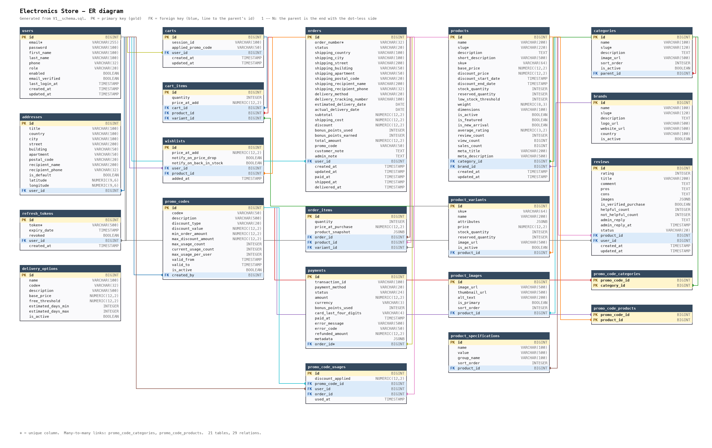

# Electronics Store Backend

CIT4040 course project. A Spring Boot REST API for an online electronics shop: customers browse the catalogue, review products, fill a cart, place an order and pay for it; staff manage the catalogue and move orders through their statuses. There is no front end: the API is the product, and the Postman collection in `postman/` demonstrates it.

**Stack:** Java 21, Spring Boot 3.5, Spring Security with JWT (jjwt), Spring Data JPA, PostgreSQL 15 (Docker), Flyway migrations, Lombok, Maven.

## Run it (from a clean clone)

You need **Java 21** and **Docker**. Nothing else (Maven is included as `./mvnw`).

```bash
git clone <this repository>
cd <the cloned folder>

docker compose up -d        # PostgreSQL on localhost:5434
./mvnw spring-boot:run      # API on http://localhost:8080
```

On first start Flyway creates the schema and loads the demo data, so the API is usable immediately. To run the tests as well (the database must be running, because the tests use it):

```bash
./mvnw clean install
```

To start over with an empty database (this **deletes all data**; the migrations rebuild it on the next start):

```bash
docker compose down -v && docker compose up -d
```

### Demo accounts

| Role | Email | Password |
|---|---|---|
| CUSTOMER | `customer@shop.local` | `Customer123!` |
| ADMIN | `admin@shop.local` | `Admin123!` |

These are fake accounts that exist only in the seed data (stored as BCrypt hashes). Anyone can also register a new customer with `POST /api/auth/register`.

### Configuration

Everything has a development default in `src/main/resources/application.yml`, so it runs without any setup. For anything real, override with environment variables:

| Variable | Default (development only) | Meaning |
|---|---|---|
| `DB_USERNAME` | `shop` | database user |
| `DB_PASSWORD` | `secret` | database password (must match `docker-compose.yml`) |
| `JWT_SECRET` | a dev placeholder | at least 32 bytes; **set your own** |

Other settings: `jwt.access-token-expiration` (15m), `jwt.refresh-token-expiration` (7d), `shop.reviews.auto-approve` (true), `shop.payment.delay-min-ms` / `delay-max-ms` (the simulated bank's 1-3 s pause).

## Try it in Postman

Import both files from `postman/`:

- `electronics-store.postman_collection.json`
- `electronics-store.postman_environment.json` (only `baseUrl` needs editing, and only if you changed the port)

The collection really changes data: it registers a customer, places and pays orders, and creates catalogue entries. It is safe to run again and again (every run uses fresh unique names). To get back to the pristine seed data, run `docker compose down -v && docker compose up -d`. The automated tests (`./mvnw clean install`) assume the pristine seed, so run them on a fresh database.

Run the **Auth** folder first (the login request stores `accessToken` and `refreshToken` for the other folders), then any folder. Every request has a test asserting its expected status code, and each folder includes deliberate failure cases (validation, not found, forbidden).

## What the API does

All paths start with `/api`. Lists are always paginated (`?page=0&size=20&sort=field,dir`). Create returns **201 with a `Location` header**, delete returns **204 with no body**.

| Area | Endpoints | Who |
|---|---|---|
| **Auth** `/auth` | `register`, `login`, `refresh`, `logout`, `change-password` | public (change-password: logged in) |
| **Profile** `/users/me` | `GET`, `PUT`, `PUT /password`, `DELETE`, and `/addresses` (list, get, create, update, delete) | logged in |
| **Products** `/products` | list with `category`, `brand`, `minPrice`, `maxPrice`, `inStock`, `rating`, `search`; `/{id}`, `/{id}/variants`, `/{id}/related`, `/featured`, `/new-arrivals`, `/best-sellers`, `/search` | public |
| **Categories** `/categories` | tree, `/{id or slug}`, `/{id}/products` | public |
| **Brands** `/brands` | list, `/{id}`, `/{id}/products` | public |
| **Reviews** `/products/{id}/reviews` | list, `/summary`, create, edit, delete | read: public; write: logged in |
| **Cart** `/cart` | get, add/update/remove item, clear, `apply-promo`, `DELETE promo`, `merge` | guests and customers (promo and merge: logged in) |
| **Wishlist** `/wishlist` | list, add, remove, `move-to-cart` | logged in |
| **Promo** `/promo/validate` | check a code against your cart or an amount | logged in |
| **Delivery** `/delivery` | `methods`, `calculate` | public |
| **Orders** `/orders` | create from cart, list, get by id or number, `cancel`, `reorder` | logged in (own orders only) |
| **Payments** `/payments` | `process`, `{orderId}/status`, `methods` | logged in |
| **Admin** `/admin/...` | `products` (+ variants, stock, activate), `categories` (+ reorder), `brands`, `promo-codes`: **ADMIN**. `orders` (list, status, tracking, note): **ADMIN or MANAGER** | staff |

Guests identify their cart with the `X-Cart-Session` header: the server issues it on the first cart write and repeats it on every guest response.

## Rules worth knowing

- **Order total**, in this exact order: `subtotal = sum(price * quantity)`; `discount` = promo discount capped at the code's maximum; `shipping` = 0 if `subtotal` reaches the delivery option's free threshold, else its base price (a free-shipping promo also zeroes it); `bonus` = requested points capped at 50% of `(subtotal - discount)`; `total = subtotal - discount + shipping - bonus * 0.01`.
- **Order status machine:** `PENDING -> CONFIRMED -> PAID -> PROCESSING -> SHIPPED -> IN_TRANSIT -> DELIVERED`, plus `CANCELLED` (from PENDING, CONFIRMED, PROCESSING) and `REFUNDED` (from PAID; from DELIVERED only through a return). Anything else is refused with 409. Customers may cancel only while PENDING or CONFIRMED.
- **Stock:** creating an order *reserves* stock atomically (all lines or none); shipping removes it for good; cancelling gives it back. `available = stock - reserved`.
- **Payment simulation** (Luhn-checked first, 1-3 s pause): `4111111111111111` always succeeds; `4000000000000002` insufficient funds; `4000000000000069` network error; `4000000000000077` suspected fraud; any other valid number succeeds 90% of the time. A failed payment returns **402** and leaves the order **CONFIRMED**, never PAID; retrying is allowed. Only the last four digits are stored. Also `PAYPAL` (always succeeds) and `CASH_ON_DELIVERY`.
- **Ownership:** another customer's order, address, cart item or wishlist entry is a plain **404**, the same answer as for something that does not exist.
- **Errors** always have one shape: `{timestamp, status, error, message, path, details}`; `details` lists the failing fields for validation errors. No stack trace, SQL or table name ever reaches a response.
- **Reviews:** one per customer per product; `isVerifiedPurchase` is worked out from the customer's DELIVERED orders, never sent by the client.

## Project layout

```
src/main/java/com/example/shop/
  controller/ (+ admin/)   thin: take a request DTO, call a service, return a response DTO
  service/ (+ impl/)       all business rules
  repository/              Spring Data interfaces
  model/entity, model/enums
  dto/request, dto/response, mapper/   hand-written mappers; no entity ever leaves a controller
  security/, config/       JWT filter and provider, SecurityConfig
  exception/               one @RestControllerAdvice, one error shape
  specification/, validator/, util/
src/main/resources/db/migration/   V1 schema, V2 seed, V3-V5 follow-ups (Flyway)
src/test/                          ~230 tests (unit, MockMvc against the seeded database)
docs/                              ER diagram (PNG + PlantUML) and the script that draws it
postman/                           collection and environment
```

## Database

21 tables, created by `V1__schema.sql` with an index on every foreign key and on the columns that are filtered or sorted by. `V2__seed.sql` loads 5 categories, 3 brands, 20 products, 2 users, 5 orders in different statuses, 10 reviews and 3 promo codes (one of them expired, for testing refusals). Hibernate runs with `ddl-auto: validate`, so it checks the entities against the schema instead of changing it. **Never edit a migration that has already run**; add a new `V<n>__...sql`.



The diagram is drawn from the schema by `docs/er/generate_er.py` (`python3 docs/er/generate_er.py`, needs Pillow), so it cannot drift from the database. `docs/er-diagram.puml` is the same diagram as PlantUML.

## Not built (optional modules)

Bonus points (so customers have no balance and cannot pay with points), returns, support tickets, notifications and emails, image upload, Redis caching, rate limiting, Swagger UI, audit log. The code is arranged so they can be added without changing the required core.
